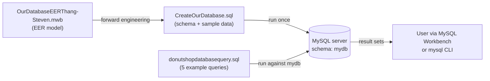
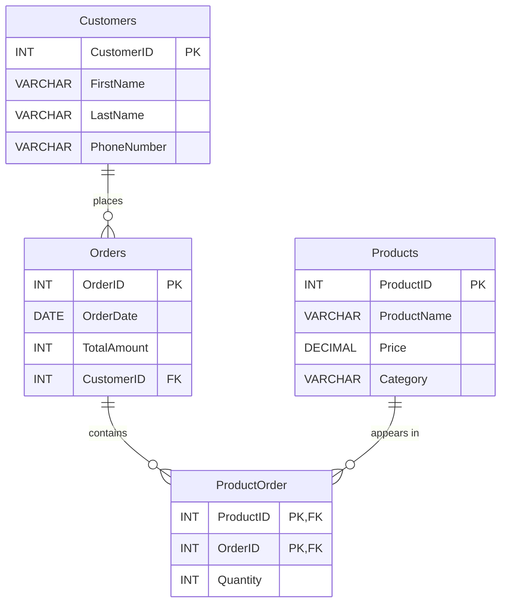

# DonutShopDatabase

A MySQL relational database for a small, locally owned donut shop. It models customers, orders, products, and the items on each order, ships with sample data, and includes five example SQL queries that answer simple business questions.

This is a course database-design project by Thang Pham and Steven Nicholson. It contains SQL scripts, a MySQL Workbench model, and a written report. There is no application, user interface, or API — you interact with it directly through a MySQL client.

---

## Table of Contents

- [Overview](#overview)
- [Features](#features)
- [Technology Stack](#technology-stack)
- [Architecture](#architecture)
- [Project Structure](#project-structure)
- [Installation and Setup](#installation-and-setup)
- [Environment Variables](#environment-variables)
- [How to Use](#how-to-use)
- [Database Design](#database-design)
- [Example Queries](#example-queries)
- [Testing](#testing)
- [Current Limitations and Future Improvements](#current-limitations-and-future-improvements)
- [Contributors](#contributors)
- [License](#license)

---

## Overview

### The problem

According to the project report ([`FinalDatabaseReport.docx`](FinalDatabaseReport.docx)), the shop sells homemade donuts, coffee, and other beverages through walk-in sales, pre-orders, and catering. It previously tracked its business with spreadsheets and paper logs, which led to:

- Inefficient order tracking
- Poor inventory management
- Limited insight into customers
- No real sales reporting

### The solution

The project designs a relational database that brings the shop's core sales data into one place. The implemented version focuses on the order-taking side of the business:

- **Who** bought something (`Customers`)
- **What** the shop sells (`Products`)
- **When** and **for how much** a purchase happened (`Orders`)
- **Which products, and how many,** were in each purchase (`ProductOrder`)

With that data in tables, the shop owner (or anyone with SQL access) can answer questions such as "how many customers do we have?", "which orders were large and recent?", or "which products are priced above average?".

### Intended audience

- Instructors and classmates reviewing the database design
- Students learning ER modeling, normalization, and basic SQL
- Anyone who wants a small, readable example of a many-to-many schema in MySQL

### How it was built

The team designed an EER (Enhanced Entity-Relationship) diagram in MySQL Workbench, then used Workbench's **forward engineering** feature to generate the `CREATE` statements. Sample `INSERT` statements and five example queries were then written by hand.

---

## Features

### Implemented

| Feature | What it does | How you use it |
|---|---|---|
| **Schema creation script** | Creates the `mydb` schema and four InnoDB tables with primary keys, foreign keys, and indexes. | Run [`CreateOurDatabase.sql`](CreateOurDatabase.sql). |
| **Sample data** | Loads 5 customers, 5 products, 5 orders, and 6 order line items. | Included at the end of `CreateOurDatabase.sql`; loads automatically. |
| **Many-to-many order modeling** | A `ProductOrder` junction table lets one order contain many products and one product appear on many orders, with a quantity per line. | Query or join `ProductOrder` with `Orders` and `Products`. |
| **Referential integrity** | Foreign keys prevent orders pointing to non-existent customers and line items pointing to non-existent orders or products. | Enforced automatically by MySQL on insert/update. |
| **Five example business queries** | Filtering, counting, grouped averages with `HAVING`, a subquery, and an inner join. | Run [`donutshopdatabasequery.sql`](donutshopdatabasequery.sql). |
| **Editable EER model** | The visual data model the SQL was generated from. | Open [`OurDatabaseEERThang-Steven.mwb`](OurDatabaseEERThang-Steven.mwb) in MySQL Workbench. |

### Planned in the report but not implemented

The project report describes a broader system. The following items appear in the report but **do not exist** in the SQL scripts or the Workbench model:

- `Ingredients` table and ingredient/inventory tracking (flour, sugar, toppings)
- `Employees` table, employee roles, and scheduling
- Customer loyalty points
- Payment method on orders
- Real-time inventory updates and automated reporting

---

## Technology Stack

| Category | Technology | How it is used |
|---|---|---|
| Database | **MySQL** (InnoDB storage engine) | Stores all tables and enforces keys/constraints. |
| Language | **SQL** (MySQL dialect) | Schema definition, sample data, and queries. |
| Modeling / dev tool | **MySQL Workbench** | EER diagram (`.mwb`) and forward-engineering of the schema. |
| Documentation | Microsoft Word (`.docx`) | Project report with business description, ER design, and query explanations. |

Not applicable to this project: frontend, backend, APIs/integrations, AI/ML, authentication, environment configuration, and deployment/hosting.

---

## Architecture

The project is a single database with no application layer. A user (or tool such as MySQL Workbench) connects to a MySQL server and runs the scripts directly.



**Data flow:** the creation script defines the tables and inserts sample rows → the query script reads from those tables → results are shown in the client. Nothing writes back except the initial `INSERT` statements.

---

## Project Structure

```
DonutShopDatabase/
├── README.md                          # This file
├── CreateOurDatabase.sql              # Creates schema `mydb`, 4 tables, and inserts sample data
├── donutshopdatabasequery.sql         # Five example queries (Query 1–5)
├── OurDatabaseEERThang-Steven.mwb     # MySQL Workbench EER model
└── FinalDatabaseReport.docx           # Project report: business case, ER design, relational forms, queries, conclusions
```

| File | Purpose |
|---|---|
| `CreateOurDatabase.sql` | Workbench forward-engineered DDL (temporarily disables unique/foreign-key checks while creating tables, then restores them), followed by hand-written `INSERT` statements for sample data. |
| `donutshopdatabasequery.sql` | Five standalone `SELECT` queries. It does not contain a `USE` statement, so select the `mydb` schema before running it. |
| `OurDatabaseEERThang-Steven.mwb` | Source of truth for the visual model. Its tables, columns, keys, and indexes match `CreateOurDatabase.sql`. |
| `FinalDatabaseReport.docx` | Written report, including the business description, business rules, cardinalities, relational schema, screenshots, query explanations, and team contributions. |

---

## Installation and Setup

The repository has no package manager, build step, or setup script. Setup means running one SQL file on a MySQL server.

### Prerequisites

- **MySQL Server 8.0 or later.** The script uses the `VISIBLE` index keyword, which was introduced in MySQL 8.0; it will fail on MySQL 5.7 and on MariaDB.
- A MySQL client: **MySQL Workbench** (recommended, since the model file is a Workbench file) or the `mysql` command-line client.

### 1. Get the files

```bash
git clone https://github.com/thangp06/DonutShopDatabase.git
cd DonutShopDatabase
```

### 2. Create the database and load sample data

**Option A — MySQL Workbench**

1. Connect to your MySQL server.
2. Choose **File → Open SQL Script…** and select `CreateOurDatabase.sql`.
3. Execute the whole script (lightning-bolt icon).
4. Refresh the **Schemas** panel; you should see `mydb` with four tables.

**Option B — mysql command line**

```bash
mysql -u <your_user> -p < CreateOurDatabase.sql
```

> **Note:** The script creates a schema named `mydb` (Workbench's default name). If you already have a schema called `mydb`, the `CREATE ... IF NOT EXISTS` statements will reuse it, and the `INSERT` statements will fail if rows with the same IDs already exist.

### 3. Run the example queries

**Workbench:** open `donutshopdatabasequery.sql`, make `mydb` the default schema (double-click it in the Schemas panel), and execute.

**Command line:**

```bash
mysql -u <your_user> -p mydb < donutshopdatabasequery.sql
```

The commands above are standard MySQL usage; the repository does not define its own scripts. They were not executed while writing this README (see [Testing](#testing)).

---

## Environment Variables

None. The project has no application code and reads no configuration. Your MySQL connection details are supplied to your own client (Workbench or `mysql`) and are not stored in the repository.

---

## How to Use

### Explore the sample data

After running the creation script:

```sql
USE mydb;

SELECT * FROM Customers;
SELECT * FROM Products;
SELECT * FROM Orders;
SELECT * FROM ProductOrder;
```

### See what was in each order

`ProductOrder` connects orders to products. This join (not part of the repo; shown as a usage example) lists every line item:

```sql
SELECT o.OrderID, o.OrderDate, c.FirstName, c.LastName,
       p.ProductName, po.Quantity, p.Price
FROM Orders o
JOIN Customers c     ON c.CustomerID = o.CustomerID
JOIN ProductOrder po ON po.OrderID   = o.OrderID
JOIN Products p      ON p.ProductID  = po.ProductID
ORDER BY o.OrderID;
```

### Record a new sale

Because IDs are not auto-incremented, you supply them yourself. Insert in this order so foreign keys are satisfied: customer → order → line items.

```sql
INSERT INTO Customers (CustomerID, FirstName, LastName, PhoneNumber)
VALUES (6, 'Ana', 'Lopez', '555-666-7777');

INSERT INTO Orders (OrderID, OrderDate, TotalAmount, CustomerID)
VALUES (6, '2026-04-06', 5, 6);

INSERT INTO ProductOrder (ProductID, OrderID, Quantity)
VALUES (3, 6, 1);
```

Behind the scenes, MySQL checks that customer 6 exists before accepting the order, and that order 6 and product 3 exist before accepting the line item. `TotalAmount` is not calculated for you — you enter it manually.

---

## Database Design

- **Engine:** MySQL, InnoDB
- **Schema name:** `mydb`
- **Character set:** `utf8`

### Entity-relationship diagram



### Tables

**`Customers`** — people who buy from the shop.

| Column | Type | Null | Key |
|---|---|---|---|
| `CustomerID` | INT | NOT NULL | PK |
| `FirstName` | VARCHAR(45) | NULL | |
| `LastName` | VARCHAR(45) | NULL | |
| `PhoneNumber` | VARCHAR(45) | NULL | |

**`Orders`** — one purchase by one customer.

| Column | Type | Null | Key |
|---|---|---|---|
| `OrderID` | INT | NOT NULL | PK |
| `OrderDate` | DATE | NULL | |
| `TotalAmount` | INT | NULL | |
| `CustomerID` | INT | NOT NULL | FK → `Customers.CustomerID` (indexed) |

**`Products`** — items the shop sells.

| Column | Type | Null | Key |
|---|---|---|---|
| `ProductID` | INT | NOT NULL | PK |
| `ProductName` | VARCHAR(45) | NULL | |
| `Price` | DECIMAL(60) | NULL | |
| `Category` | VARCHAR(45) | NULL | |

**`ProductOrder`** — junction table: which products are on which order, and how many.

| Column | Type | Null | Key |
|---|---|---|---|
| `ProductID` | INT | NOT NULL | PK (composite), FK → `Products.ProductID` |
| `OrderID` | INT | NOT NULL | PK (composite), FK → `Orders.OrderID` |
| `Quantity` | INT | NULL | |

All foreign keys use `ON DELETE NO ACTION` and `ON UPDATE NO ACTION`, so you cannot delete a customer that has orders, or an order/product that has line items, without deleting the dependent rows first.

### Relationships

| Relationship | Cardinality | Notes |
|---|---|---|
| Customers → Orders | 1 : M | Each order belongs to exactly one customer (`CustomerID` is `NOT NULL`). |
| Orders → ProductOrder | 1 : M | One order can have many line items. |
| Products → ProductOrder | 1 : M | One product can appear on many orders. |
| Orders ↔ Products | M : N | Resolved through `ProductOrder`; the composite key means a product appears at most once per order (use `Quantity` for multiples). |

### Sample data

| Table | Rows | Contents |
|---|---|---|
| `Customers` | 5 | John Smith, Maria Garcia, James Brown, Emily Davis, Michael Wilson (fictional, `555-` phone numbers) |
| `Products` | 5 | Glazed Donut, Chocolate Donut (Donut); Coffee, Iced Coffee (Drink); Bagel (Breakfast) |
| `Orders` | 5 | One per customer, dated 2026-04-01 through 2026-04-05 |
| `ProductOrder` | 6 | Order 1 has two products; orders 2–5 have one each |

---

## Example Queries

All queries are in [`donutshopdatabasequery.sql`](donutshopdatabasequery.sql). Descriptions and business uses come from the project report. The expected results were worked out by hand from the sample data and were **not** produced by running the queries.

| # | Purpose | SQL technique | Expected result with sample data |
|---|---|---|---|
| 1 | Large, recent orders: `TotalAmount > 7` on or after 2026-04-03 | `WHERE` with `AND` | Orders 3, 4, 5 |
| 2 | Total number of customers | `COUNT(*)` | 5 |
| 3 | Product categories with an average price above $3 | `GROUP BY` + `HAVING` | Drink, Breakfast |
| 4 | Products priced above the overall average price | Scalar subquery | Iced Coffee, Bagel |
| 5 | Which customer placed which order | `INNER JOIN` | 5 rows (one per order) |

```sql
-- Query 3 example
SELECT Category, AVG(Price) AS Average_Price
FROM Products
GROUP BY Category
HAVING AVG(Price) > 3;
```

See the price-rounding note under [Limitations](#confirmed-issues-in-the-current-scripts) — it changes the averages shown by queries 3 and 4, though not which rows are returned.

---

## Testing

There is no automated test suite. Validation in this project was manual: the report contains screenshots of the created schema, tables, and query results from MySQL Workbench.

While writing this README, a MySQL 8 server was not available, so neither script was executed. The schema description was verified by reading `CreateOurDatabase.sql` and cross-checking it against the Workbench model; query results above are hand-derived.

A simple way to check a fresh install:

```sql
USE mydb;
SELECT 'Customers', COUNT(*) FROM Customers
UNION ALL SELECT 'Products', COUNT(*) FROM Products
UNION ALL SELECT 'Orders', COUNT(*) FROM Orders
UNION ALL SELECT 'ProductOrder', COUNT(*) FROM ProductOrder;
-- Expect 5, 5, 5, 6
```

---

## Current Limitations and Future Improvements

### Confirmed issues in the current scripts

These were found by reading the SQL; they are not runtime-tested.

- **Prices lose their cents.** `Price` is declared `DECIMAL(60)`, which MySQL treats as `DECIMAL(60,0)` — no decimal places. Inserted prices like `2.50` and `3.50` are rounded to whole dollars (3 and 4). Something like `DECIMAL(6,2)` would store them exactly.
- **`TotalAmount` is a whole-dollar `INT`** and is entered by hand rather than calculated from line items. In the sample data it does not match the line items for orders 3, 4, and 5 (e.g., order 5 is three $2 Glazed Donuts but has a total of 12).
- **No auto-increment IDs.** Every `INSERT` must supply its own primary-key value.
- **Not re-runnable.** Running `CreateOurDatabase.sql` a second time fails on duplicate primary keys in the `INSERT` statements.
- **Generic schema name.** The schema is named `mydb` (Workbench's default), which can collide with other projects.
- **Business rules not enforced.** The report states that a customer must have at least one order and an order must have at least one product. Nothing in the schema enforces either rule.
- **MySQL 8+ only.** The `VISIBLE` index option prevents the script from running on MySQL 5.7 or MariaDB.

### Not yet implemented (from the report)

- `Ingredients` and inventory tracking
- `Employees`, roles, and schedules
- Loyalty points on customers
- Payment method on orders

### Possible improvements (recommendations)

- Use `DECIMAL(6,2)` for `Price` and `TotalAmount`, or compute order totals with a view instead of storing them.
- Add `AUTO_INCREMENT` to the ID columns.
- Rename the schema (e.g., `donut_shop`) and add `USE` to the query script.
- Add `CHECK (Quantity > 0)` and `NOT NULL` on required fields such as `ProductName` and `Price`.
- Split the sample data into its own seed file so the schema can be recreated independently.
- Implement the planned `Ingredients` and `Employees` tables.

---

## Contributors

From the team contributions table in [`FinalDatabaseReport.docx`](FinalDatabaseReport.docx):

| Member | Contributions |
|---|---|
| **Thang Pham** | Database description, queries, conclusion |
| **Steven Nicholson** | ER model description, relational-form representation of normalized entities, database implementation |

The team coordinated through weekly Discord calls, Discord chat, and a shared Google Drive.

---

## License

No license file is included in this repository.
